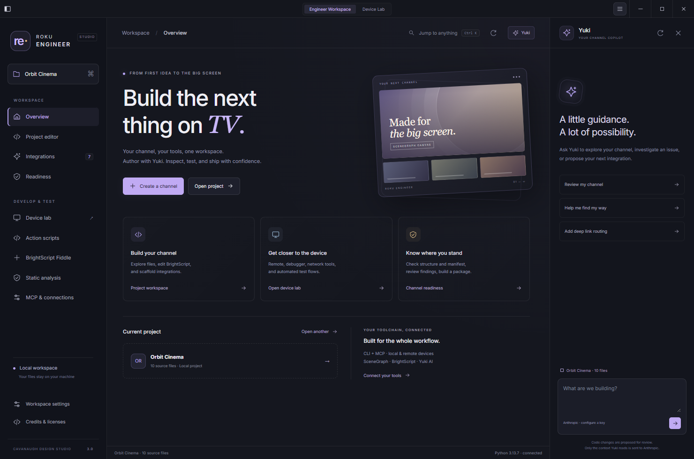
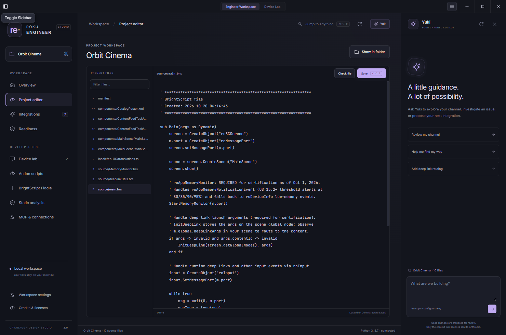
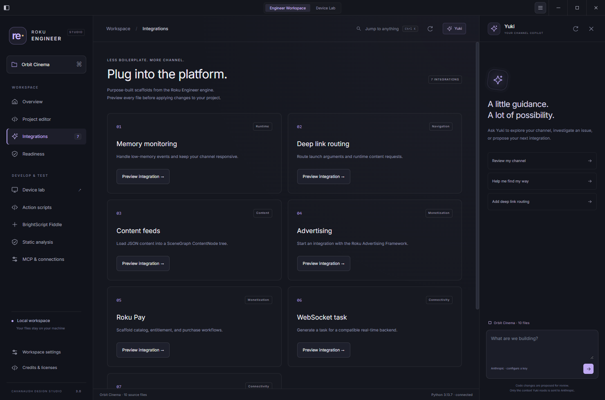
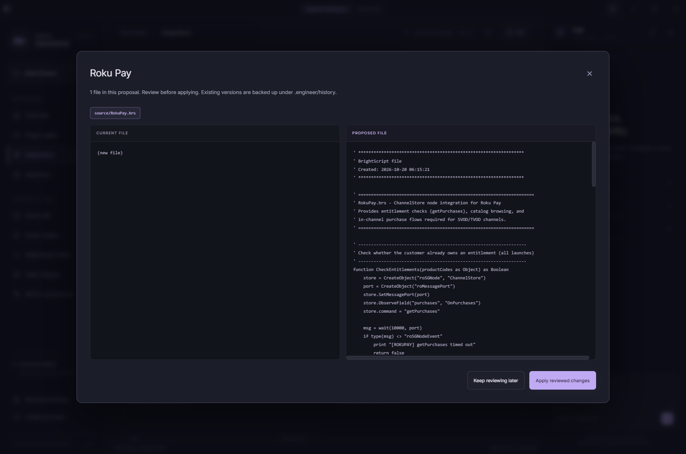
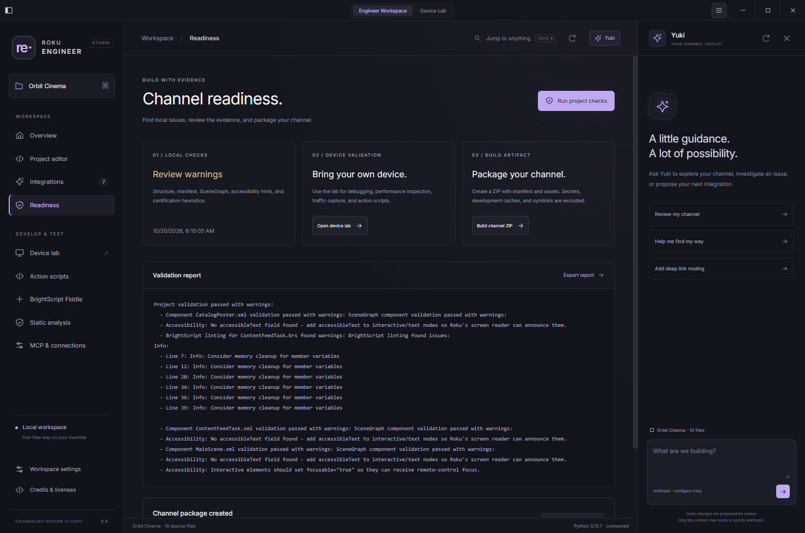
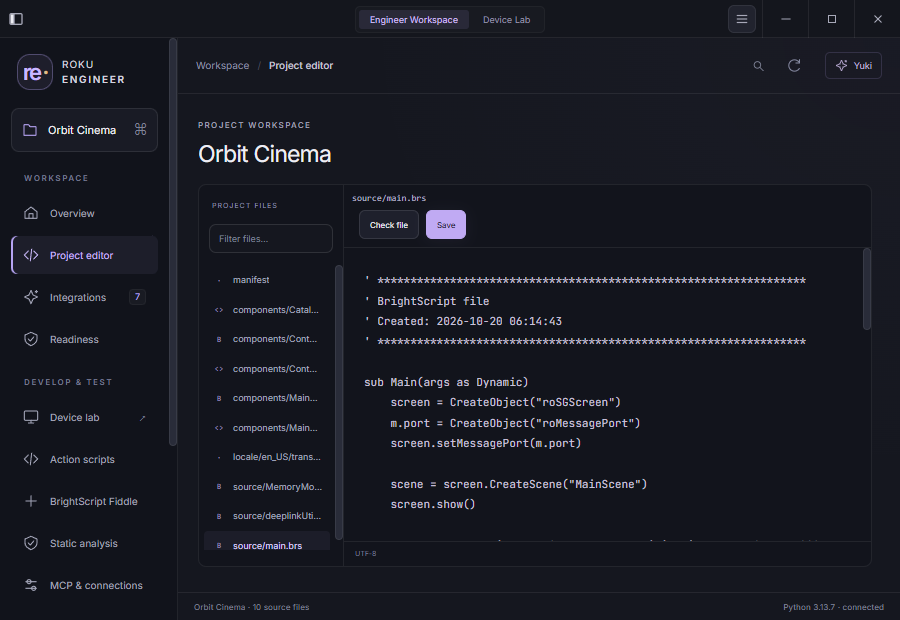

# Roku Engineer

**Build the next thing on TV.**

AI-assisted channel authoring and a complete Roku device lab in one desktop workspace. Create and edit BrightScript / SceneGraph projects, review Yuki’s proposed changes, inspect running channels, automate tests, and build sideloadable ZIPs.



## The whole workflow

| Build | Inspect | Automate |
| --- | --- | --- |
| SceneGraph, content-grid, and SGDEX starters | Local discovery and device connections | Action Scripts with variables and branches |
| Project browser, editor, command palette | Remote, app management, device queries | Builder, pause/resume/stop, run artifacts |
| Seven integration generators and file previews | Telnet, socket debugger, RALE / App Connector | Headless `roku-engineer` CLI |
| Yuki assistant with scoped project tools | Network inspector, traffic rules, HAR / PCAP | MCP tools for AI hosts |
| Validation, reports, channel packaging | CPU / memory charts and screenshots | Remote labs and cloud-emulator connections |

### Engineer Workspace

- **Create or open a channel.** Starters include a manifest, launch loop, memory-monitor and deep-link helpers, plus generated artwork. SGDEX projects require the official SGDEX components before deployment.
- **Edit with confidence.** Filter source files, jump with `Ctrl/Cmd+K`, and save with `Ctrl/Cmd+S`. Saves detect external changes and retain prior contents in `.engineer/history/`.
- **Preview integrations.** Generate memory monitoring, deep linking, content feeds, RAF advertising, Roku Pay, WebSockets, and server-sent events. Review before/after files before applying changes.
- **Work with Yuki.** Explore code, investigate issues, and prepare file-change proposals. Yuki can read source, run local checks, and preview generators; edits wait for your review.
- **Check and package.** Export local validation reports and build ZIPs under `.engineer/artifacts/`. Environment files, hidden folders, caches, private-key formats, and symlinks are excluded.

### Device Lab

Switch from **Engineer Workspace** to **Device Lab** in the title bar:

- SSDP / subnet discovery, manual and multiple-device connections, remote locations, and Roku Cloud Emulator accounts.
- D-pad / media / keyboard control, floating remote, app launch / management, deep links, screenshots, and performance charts.
- Encrypted developer-password storage, sideloading, and multi-device sideload relay.
- Searchable telnet console, saved-log viewer, port terminals, socket debugger, breakpoints, stepping, threads, variables, and watches.
- RALE / App Connector calls, SceneGraph node updates, registry tools, and TrackerTask integration / export.
- Network proxy, optional packet capture, request / response search, mock / block / throttle rules, and saved-session viewers.
- Action Script builder / executor / library, variables and conditions, test artifacts, and PDF exports.
- Monaco BrightScript Fiddle and Roku’s official static-analysis launcher.

The device lab supports six interface languages. Engineer Workspace currently uses English.

## A closer look

### A workspace for the channel you are building

| Project editor | Integration library |
| --- | --- |
|  |  |
| Browse your source, keep your changes safe, and work with Yuki in context. | Add platform features with purpose-built generators. |

### Review every change before it reaches your project



| Channel readiness | A comfortable fit for smaller windows |
| --- | --- |
|  |  |
| See the findings, export a report, and build your channel ZIP. | The editor adapts, and Yuki becomes a drawer you can open when needed. |

These screenshots come from the running desktop application. Resize the window, collapse Yuki for more editor space, or reopen the assistant with the **Yuki** button. Use the top-right maximize / restore button to fill the desktop; on Windows and Linux, press **F11** for fullscreen and press it again to return.

## Run from source

Requirements: **Node.js 24.17+**, npm, and **Python 3.10+**. Python 3.13 on Windows is included in local verification. Hardware workflows require a Roku device; project tools work without one.

```bash
git clone https://github.com/Cavanaugh-Design-Studio/Roku-Engineer.git
cd Roku-Engineer
npm ci
python -m pip install -r requirements.txt
npm start
```

Run npm commands from the repository root. Installation builds shared libraries; `npm start` builds the desktop app. If your package manager blocks Electron’s install script, approve it or run `node node_modules/electron/install.js`.

For an isolated Python environment on Windows:

```powershell
python -m venv .venv
.\.venv\Scripts\python.exe -m pip install -r requirements.txt
```

The workspace detects the root `.venv`. You can also set the Python executable in **Workspace settings** or with `ROKU_ENGINEER_PYTHON`.

## Enable Yuki

In **Workspace settings**, enter an Anthropic model ID available to your account and an API key. Saved keys use OS encrypted storage and are not returned to the renderer. Alternatively, set `ANTHROPIC_API_KEY` and `MAINMODEL` in your environment or root `.env`.

Project authoring, generators, validation, and packaging work without an AI key. Chat sends messages and files Yuki reads to Anthropic; keep credentials out of source and chat. Model availability, billing, and quota are controlled by Anthropic.

The original terminal remains available through `python roku_engineer.py`, including voice mode, Tavily research, automode, and its tool catalog. Configure services using `example.env`. See the [terminal guide](docs/terminal-guide.md) and [user guide](userguide.md).

## CLI, MCP, and remote labs

```bash
npm run roku-engineer -- --help
npm run roku-engineer -- discover
npm run roku-engineer -- device info --ip 192.168.1.42
npm run roku-engineer -- script validate ./test-flow.json
```

See the [device API / CLI guide](packages/roku-engineer-studio-api/README.md). Open **MCP & connections** to configure supported AI hosts; keep the app running for live device tools. The independent MCP server identity is `roku-engineer-studio`. See the [MCP guide](packages/roku-engineer-studio-mcp/README.md).

Run `npm run ci:remote-check`, then `npm run remote-server` for a lab relay. Configure `ROKU_ENGINEER_RELAY_TOKEN` and protected networking / TLS before exposing device control outside a trusted lab. See the [relay setup](packages/roku-engineer-studio-remote-server/README.md). Cloud-emulator workflows require your own account.

## Verify and build

```bash
npm run typecheck
npm test
npm run engine:test
npm run test:engineer
npm run studio:build
npm run studio:smoke
npm run build:win
```

The Electron smoke test uses an isolated profile, real IPC and Python, and scripted native pickers. Screenshots and its report go to `artifacts/studio-qa/`. Windows, macOS, and Linux build targets are included; signing and notarization require your credentials.

**Verification boundaries:** generators are scaffolds; local readiness checks do not certify a channel. Use Roku’s official analysis and representative devices before submission. Hardware, installed MCP hosts, paid cloud services, and live AI calls require separate acceptance. Packet capture needs platform drivers / permissions; official static analysis requires Java 21+ and its runtime download.

See the [capability inventory](docs/capability-inventory.md), [architecture](docs/architecture.md), [validation record](docs/validation.md), and [desktop installation guide](docs/studio-installation.md).

## Repository

- `apps/roku-engineer-studio/` — Electron app and Engineer Workspace.
- `packages/roku-engineer-studio-*/` — device API / CLI, MCP, network inspector, cloud client, platform helpers, relay.
- `roku-components/` — device companion components and demo.
- `roku_engineer.py`, `system/` — original engine and assistant prompts.
- `engineer_bridge.py` — scoped project-authoring JSON bridge.
- `tests/` — workspace / agent regression checks.

## License

MIT. See [LICENSE](LICENSE) and the separate [distribution notices](third_party/NOTICE.md).
