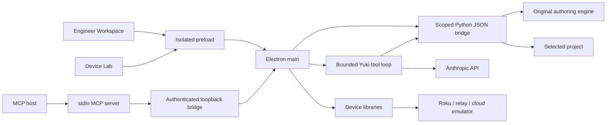

# Architecture

The original Python engine and terminal remain at the repository root. The Electron application adds Engineer Workspace and a full device-development stack.

## Project boundary

`shared/engineer.ts` defines the renderer contract. `main/engineer-service.ts` checks that the caller is the main renderer and retains its selected project and revision. The renderer cannot supply a root: opening or creating a project uses a native directory picker. Switching projects clears editor and chat context.

Each authoring action spawns `engineer_bridge.py` with a JSON request over stdin. Stdout contains one JSON response; optional-library output is redirected. Calls have output and time limits. A root `.venv` is detected, or the user can configure Python explicitly. Packaged applications include the Python source under `resources/engine/`; Python and dependencies remain external prerequisites.

The bridge has a small action allowlist, with no shell action. Source reads/writes reject absolute or escaping paths, hidden files, unsupported types, and symlink escapes. Enumeration excludes caches and tooling folders and caps files at 2 MB, 2,000 entries, and 40 MB total. Packaging excludes hidden files, environment files, private-key formats, caches, symlinks, and previous archives.

Generator previews run in temporary snapshots. Apply checks every path and expected hash before touching files, retains previous bytes in `.engineer/history/<id>/`, and replaces files atomically. A failure attempts to roll back completed writes. Recovery from retained history is manual in this version. Refresh the project after a timeout before retrying a write.

## Yuki

`main/engineer-agent.ts` limits work to seven model turns and sixteen tool calls. Tools read source, validate locally, preview generators, and propose complete file contents. They do not run shell commands or apply proposals. The UI provides a before/after review and explicit Apply action; hash checks apply to model proposals too.

Requests use Anthropic's fixed HTTPS Messages API endpoint. Keys are read from the environment / root `.env` or OS-encrypted main-process preferences; the renderer receives status only. Provider error bodies are not echoed. Stop aborts the provider and pending read/preview calls. Conversations remain in memory and are cleared on project change or user reset.

## Device compatibility and identity

The complete device implementation is retained under `apps/` and `packages/`. The app name, user-data directory, MCP entry/executable, CLI binary, artifact names, updater repository, CA identity, and package names are independent. Existing Action Script schemas, ECP / RALE / debugger wire contracts, and `.rds-network-inspector.json` capture compatibility are retained.

The MCP server targets the device lab; it does not expose workspace filesystem access or Yuki configuration. Remote, cloud, proxy, capture, and hardware paths retain separate acceptance gates.

The experimental Solid renderer remains a development migration surface. `npm start` defaults to the full HTML / TypeScript application.

## Maintenance

The source baseline and MIT notice are pinned in `third_party/NOTICE.md`. This is a maintained source integration, not an automatic upstream updater. Future changes must preserve workspace isolation, independent runtime identity, notices, and contract tests. Packaging includes the third-party notices.
